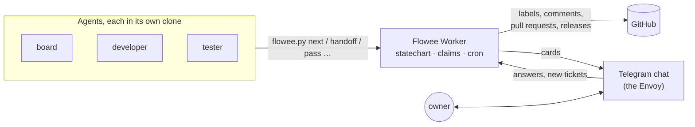

<div align="center">


# Flowee

**A configurable ticket flow for AI agent teams, with the human's inbox in a chat.**

[](LICENSE)
[](https://workers.cloudflare.com/)
[](tsconfig.json)
[](client/flowee.py)
[](docs/telegram.md)
[](CLAUDE.md#build-test-run)

</div>

## What it is

Flowee runs the ticket flow of a team of AI agents over GitHub issues: a board specifies, developers build, testers
test, and each step is a command the service checks against a statechart. The tickets that need a human (tests,
questions, decisions) reach the owner as cards in a Telegram chat, answered by replying. Everything specific to a
project (repositories, roles, flow, texts, chat) is one JSON document.

## How it works



- The **tracker is the record**: a ticket's state is a label on its issue. Every command re-reads the issue.
- An agent's run is short: take work with `next`, do it, hand it over, stop. Claims expire after three hours.
- Only the board puts a ticket in front of the owner. The owner answers in the chat; the answer goes back to the
  board.

## Quick start

Flowee is a Cloudflare Worker. You need a Cloudflare account, `bun`, a GitHub token and a Telegram bot. It runs in one
of two modes.

Your deployment's configuration goes into `flowee.config.local.json`: it is git-ignored, so the chat ids and URLs
in it never land in a commit. `bun run deploy` validates it, deploys the Worker with it (as the `FLOWEE_CONFIG`
secret; without the file, the committed `flowee.config.json` is used), and calls `<url>/setup`, where the bot
sets its own name, descriptions, commands, settings, photo and webhook, each only when changed. The mode follows
the document: managed when it has an `instance` section, else standalone.

### Standalone: one preconfigured instance

The workspaces are fixed at deploy time. No setup happens in the chat.

```sh
git clone https://github.com/Nachtalb/flowee && cd flowee && bun install
$EDITOR flowee.config.local.json            # {"flowee": 1, "workspaces": [<the workspace document, see below>]}
bun run validate flowee.config.local.json   # the Worker's own validator; exit 0 = valid
```

Store every secret the document names (the first `secret put` creates the Worker), then deploy:

```sh
bunx wrangler secret put ACME_GITHUB_TOKEN       # a fine-grained token on the repositories
bunx wrangler secret put TELEGRAM_BOT_TOKEN
openssl rand -hex 32 | bunx wrangler secret put TG_WEBHOOK_SECRET
# an agent's secret is stored as its SHA-256 only; the agent keeps the secret itself
printf %s "$DEV1_SECRET" | sha256sum | cut -d' ' -f1 | bunx wrangler secret put ACME_DEV1
bun run deploy                                   # deploy + GET <publicUrl>/setup
```

### Managed: workspaces set up in the chat

One instance serves many workspaces. Each user creates theirs with a setup wizard in the chat, with the instance bot
or with an own bot Flowee creates for the workspace.

1. Write `flowee.config.local.json` with the instance section: the bot's secret names and username, the public
   URL (`https://flowee.<subdomain>.workers.dev`), the owner's Telegram id, who may create workspaces
   ([docs/configuration.md](docs/configuration.md#instance)).
2. Store the secrets, each from stdin: the bot token and the webhook secret the document names, `FLOWEE_KEY` (seals
   the secrets entered in the chat; keep a copy, losing it makes them unreadable) and `FLOWEE_ADMIN_TOKEN` (the
   configuration API).
3. `bun run deploy`. It prints the `/setup` result: `name`, `description`, `short_description`, `commands`,
   `settings` (this also turns on bot management, for own bots), `photo`, `webhook`, each `set` or `current`.
4. In a private chat with the bot: `/setup`. The wizard asks for the bot, the repositories, the flow, where the cards
   go, the GitHub token and the number of agents, and hands over the agents' secrets once with a ready
   `.flowee.toml`.

Details: [docs/managed.md](docs/managed.md), [docs/telegram.md](docs/telegram.md).

## Configuration

A workspace is one JSON document. A minimal, complete one:

```json
{
  "flowee": 1,
  "id": "acme",
  "flow": { "preset": "trunk" },
  "tracker": { "type": "github", "repos": ["acme/app"], "token": "ACME_GITHUB_TOKEN" },
  "roles": [
    { "instance": "board", "role": "board", "secret": "ACME_BOARD" },
    { "instance": "dev1", "role": "developer", "secret": "ACME_DEV1" },
    { "instance": "tester", "role": "tester", "secret": "ACME_TESTER" },
    { "instance": "owner", "role": "owner", "secret": "ACME_OWNER" }
  ],
  "owners": [{ "name": "Ann", "tracker": "ann", "chat": "123456789" }],
  "chat": {
    "type": "telegram", "token": "TELEGRAM_BOT_TOKEN", "webhookSecret": "TG_WEBHOOK_SECRET",
    "chatId": "123456789", "publicUrl": "https://flowee.acme.workers.dev"
  }
}
```

- A document never holds a secret, only its name (`ACME_GITHUB_TOKEN`). The values are Worker secrets, or sealed
  secrets in the managed mode.
- Several repositories in one workspace: tickets are written `alias#12`.
- The chat can be a private chat, a group, or one topic of a forum group (`chat.topicId`).
- Every field, default and rule: [docs/configuration.md](docs/configuration.md);
  JSON Schema: [schema/workspace.schema.json](schema/workspace.schema.json).

### Flow presets and feature switches

| Preset | Flow |
|---|---|
| `trunk` | Developers commit to the main branch; the tester tests it; the board reviews and escalates. |
| `pr-release` | `trunk` plus the feature switches below, each off unless the document turns it on. |

| Feature | Adds |
|---|---|
| `pullRequests` | A branch and a pull request per ticket; hand-off needs the checks green; `pass` merges (or the developer does). |
| `releases` | Which release contains a ticket; test cards held until it is released; a version line; a `tested` tag. |
| `samples` | A `sampler` role that finds a real sample file before development starts. |
| `uiReview` | A `pass` that changes the UI goes past the owner first. |
| `dependencyTickets` | One ticket per dependency pull request (e.g. Dependabot). |
| `untrustedReports` | Tickets with text from outside go to the board only, until it checked them. |

What each one does in detail: [docs/flow-features.md](docs/flow-features.md). Your own statechart (XState JSON,
editable in Stately): [docs/flows.md](docs/flows.md).

## The client

`client/flowee.py` is one Python file (3.11+, standard library only). Copy it into the project repository and add a
`.flowee.toml` at its root:

```toml
url = "https://flowee.acme.workers.dev"
workspace = "acme"
instance = "dev1"                                         # or FLOWEE_AS
secret_file = "~/.secrets/flowee/{workspace}/{instance}"  # or FLOWEE_TOKEN

[[gates]]
name = "test"
cmd = ["bun", "run", "test"]
```

| Role | Commands |
|---|---|
| everyone | `whoami`, `queue`, `show N`, `next`, `heartbeat N`, `release N`, `file TITLE` |
| developer | `gates`, `commit N MSG`, `push`, `handoff N`, `stuck N`; with pull requests `branch N`, `pr N`, `checks N`, `merge N` |
| tester | `gates`, `pass N [--owner-check]`, `fail N`, `stuck N` |
| board | `triage N`, `spec N`, `sendback N`, `rework N`, `escalate N`, `approve N`, `drop N`, `postpone N`, `resume N`; `needsamples N`, `checked N` |
| sampler | `found N PATH…`, `unobtainable N` |
| owner | `answer N` (usually through the chat) |

Comments and bodies come on stdin. Exit codes: `0` ok, `1` failure, `2` refused, `3` `next` found nothing. `busy`
tells whether a clone has fresh uncommitted work. The full contract: [docs/api.md](docs/api.md).

How to run agents against Flowee (roles, one run, what a cheap pre-check looks at):
[docs/agents/](docs/agents/README.md). Agent skills for installing, using and configuring Flowee:
[skills/](skills/).

## Export and import

- Managed mode, in the chat: `/export` sends your workspaces as a file; send a `.json` file to the bot (or `/import`
  and paste it) to create or replace one. Only what is missing is asked afterwards.
- Managed mode, over HTTP: `PUT /admin/workspaces/<id>` with the document, `PUT …/secrets` with the values
  ([docs/api.md](docs/api.md#configuration-api-managed-mode)).
- Standalone: edit `flowee.config.local.json` and `bun run deploy` again.

Exports never contain a secret.

## Documentation

| Topic | Where |
|---|---|
| The agents' HTTP API and the client | [docs/api.md](docs/api.md) |
| Configuration and secrets | [docs/configuration.md](docs/configuration.md) |
| Statecharts, guards, actions | [docs/flows.md](docs/flows.md) |
| Feature catalogue | [docs/flow-features.md](docs/flow-features.md) |
| The chat interface | [docs/envoy.md](docs/envoy.md), [docs/telegram.md](docs/telegram.md) |
| Managed mode, wizard, import | [docs/managed.md](docs/managed.md) |
| Running agents | [docs/agents/](docs/agents/README.md) |
| Ports and adapters (Discord, another tracker) | [docs/adapters.md](docs/adapters.md) |
| Building and changing Flowee | [CLAUDE.md](CLAUDE.md) |

## Licence

[MIT](LICENSE)
