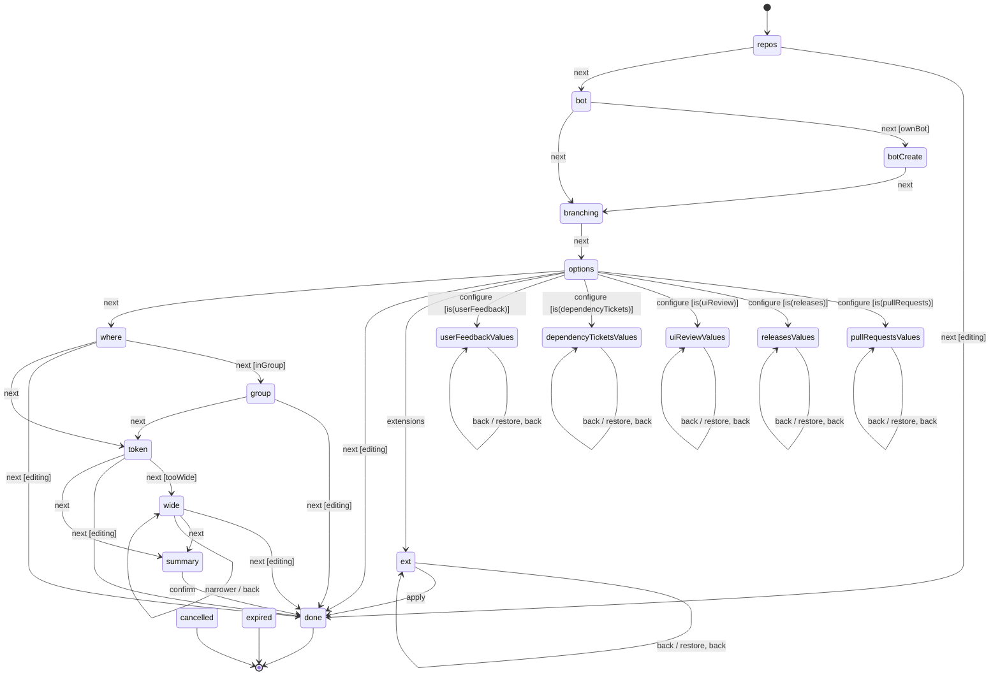

# The managed mode: setup wizard, management, import

`FLOWEE_MODE=managed` turns one Worker into an instance that many people can set up workspaces on, in the chat.
Everything runs in the Worker: the Instance Durable Object keeps the workspaces (a stored `WorkspaceRegistry`),
their sealed secrets, the wizard sessions and the bots made for workspaces; each workspace keeps its own
Durable Object as in the standalone mode. The code is chat-agnostic (`src/wizard/`: steps, prompts, choices,
validation) and reaches the chat through the `Chat` port; the Telegram adapter maps views to messages and buttons.

## The wizard (`/setup`, or `/start` → 🚀 Set up a workspace, in a private chat with the instance bot)

The whole setup is one message that each step edits (docs/chat-style.md): the heading `🆕 New workspace · Step k of
n`, the step's question in bold, one line of help, the choices as table rows: each row an option's name, its one-line
description and its own button; Back, Next and Cancel in the bottom row. A typed answer (a repository, the token) is
deleted right after it is read, and the result shows in the same message, a mistake as one `⚠️` sentence under the
question.

Every screen of the path is one step: `Step n of N` counts them, from 1 to the last check. This bot in a private
chat is 7 screens (repository, bot, branching, options, where, token, last check); a new bot adds the screen that
creates it, a group the group's screen, a token that reaches more than it needs the screen that says so; N changes
the moment such a choice is made. Without own bots the bot screen is not asked, in the terminal neither is the chat.

| Screen | Asks | Notes |
|---|---|---|
| Repository | "Which repository is this workspace for?": the link as pasted from GitHub or GitLab, or `owner/name`; several at once | `https://github.com/o/n/issues/3`, `github.com/o/n`, `git@github.com:o/n.git`, `<…>`, `https://gitlab.com/g/sub/p/-/issues/3` all work: the tracker registry (`recognise()` in `src/adapters/trackers.ts`, each kind's `parseRepo`) reads them, an Enterprise host too; a self-managed GitLab is recognised by a host starting with `gitlab.` or GitLab's `/-/` routes, its API taken as `https://<host>/api/v4`. The screens say which tracker it recognised (`Now: … on GitLab`, the summary). One tracker per paste: a workspace on several trackers is written as a configuration and imported (docs/configuration.md). The workspace id comes from the first repository's name (unique: `-2`, `-3`). With several, tickets are `alias#n`, the alias being the repository's name (two of the same name: `owner-name`, instead of a refusal). Back offers ✅ Keep. |
| Bot (and creating a new one) | Rows: 💬 This bot · 🤖 A new bot, each with its Choose button | A new bot: its own name, picture and commands. 🤖 Create the bot is the one reply keyboard (`KeyboardButtonRequestManagedBot`, name and username suggested from the repository; docs/telegram.md); the `managed_bot` update hands the bot over: its token is fetched (`getManagedBotToken`), sealed, its webhook set to `<publicUrl>/telegram/w/<id>` with its own secret; the keyboard and its helper message go, and so does Telegram's note about the new bot. |
| Way of working | Two screens. First the branching, exactly one row each: 🌿 Single branch · 🔀 Feature branches. Then **What else should Flowee do?**: each option a row with its state, name, one-sentence description and button: 📦 Releases, and under **More options** UI review, Dependency updates, User feedback (its description says what the current position does: on, an agent sorts feedback-labelled tickets like any other; off, they wait for you first). With Feature branches a ⚙️ Feature branches row above them shows its settings with ⚙️ Change | **An option is never a dead end.** One that needs values (`INPUTS` in `src/wizard/inputs.ts`: Feature branches: branch name, required checks, merge method, who merges; Releases: wait for a release, what counts as released (the newest release, or a git tag you move, then that tag), and under ⚙️ Advanced the tag Flowee keeps on tested code; UI review: the UI files; Dependency updates: opened by, and under Advanced the labels; User feedback: the label) has ⚙️ Configure, which opens its values screen (a detour from the options, headed with the option's name instead of a step): one row per value with its current value in words (`Now: off.`), the choices as buttons (the current one `●`), common values as rows to add or remove (`added` / `not added`), ✏️ Type (the next message is the value; a list takes one per line), and a sent `.json` (`{"paths": [...]}`) or text file, so an agent can prepare it (the screen does not say so: docs/chat-style.md, "never explain how to use the interface"). ⚙️ Advanced shows the rarely needed rows; one with a value is always shown. ✅ Apply turns the option on only when its required values are usable (else one sentence: `UI files: add at least one.`); ◀ Back leaves it as it was; Switch off keeps the values. Once on, its row shows the values and ⚙️ Change opens the screen again, also later from the menu (✏️ Change beside the way of working). The last row, 🧩 Custom steps · Steps and rules of your own, from an extension file, opens a screen that says in two sentences what an extension is (docs/flows.md, "Extending the flow", and the instance's `/flows/flow.json` to start from) and takes the `.json` file: validated with the workspace's other extensions, the problems as a one-column table in the living message, an added one listed by name with ✖ Remove; ✅ Apply keeps them, ◀ Back puts back what was there; its roles are offered to the agents (`GET /v1/roles`). Values equal to the defaults are not written. The document gets `flow.preset` `trunk` (Single branch) or `pr-release` (Feature branches) and every switch in `features` (docs/flow-features.md). |
| Where tickets appear (and the group) | Rows: 💬 Here (own bot: 💬 In my private chat, with ↗ Open in the same row); 👥 In a group | The group screen, two rows: 👥 A whole group with 👥 Choose a group (the link `t.me/<bot>?startgroup=<id>`: Telegram adds the bot and sends `/start <id>` in the group, which binds it) and 🧵 One topic of a forum group with 📋 Copy (`/bind <id>`, sent inside the topic). Only the user running the setup can bind; the group gets `✅ Tickets of <id> appear here`. |
| Tracker token (and a token that reaches too much) | The token as a message | 🔑 Create a token opens the tracker's form with what its link can fill in (the registry's `tokenHelp`; a one-column table of permissions). GitHub: name, description, resource owner (`target_name`), the permissions and the expiry (`expires_in`, `tracker.tokenDays`, default 366); its link cannot preselect repositories, so a highlighted 👉 row says to choose Only select repositories and pick them. GitLab, one project: its project access token page (no prefill: a 👉 row names the token, role, scope and expiry) with a prefilled personal token (name, description, scope) as the other row; several projects: the personal token. After the probe, the token's reach is listed (`reach()`: GitHub `/user/repos`, GitLab `/projects?membership=true`); when it sees other repositories the screen says so in one sentence and offers ✅ Use it anyway or 🔑 Make a narrower one. The message is deleted at once (if Telegram refuses, the screen asks the user to delete it); the token is checked against every repository with that tracker's adapter (`probe()` → 200), sealed, never shown again or exported. |
| Last check | What it will be as a two-column table (🗝 Project key: `a new one, shown once`), then ✅ Create the workspace | Creates the workspace, sets the own bot's profile, settings and webhook, then the screen says `✅ Workspace ready` with "Below is the workspace's project key for flowee.py, shown only this once. … Your agents read the roles and create themselves with it; you see them in 📂 My workspaces.", and the key comes **once** as a file (a new message: it must stay) that explains itself: the block storing it with mode 600 (`install -m 600 /dev/stdin`, nothing in a command's arguments), the `.flowee.toml` for the repository, and the three commands an agent runs (`roles`, `agents add developer dev1`, `agents`; docs/agents/README.md, "The key file"). Under the file: 🗑 Delete this file from the chat and ❓ How do I use this?; only the key's SHA-256 is stored. |

There is no agents step: an agent is an identity (a name its claims, leases and resuming hang on), not something to
count up front. The agents create themselves with the key through the API (docs/api.md, "Agents"), every run
idempotently, and the menu shows them.

Every step has ◀ Back and ✖ Cancel. An unfinished setup is kept: `/setup` again offers ▶ Continue or 🆕 Start
over; after a day without an answer it expires (the next touch says so; nothing was created). Who may create
workspaces: `instance.creators` (default: the instance owner), at most `instance.limits.workspacesPerUser` each.

### The setup as a statechart

The wizard's navigation is one chart, `src/wizard/setup.json` (XState v5 JSON like `flows/flow.json`; xstate's
`createMachine` loads it in `test/setup-chart.test.ts`). Every screen is a state, every button an event (its
callback data `w:<event>[:<value>]`), and guards over the draft pick the next screen; no screen decides where to go.
`src/wizard/chart.ts` runs it: a press first reads its input into the draft (the repository, the token, a value; a
refusal stays on the screen with one sentence), then the first transition whose guard holds runs its actions and
enters its target.

- **Back** is the chart's root `back`: the session keeps the current state and a **history** of the screens shown
  before it; Back pops it, so it always shows the screen you came from, and the same press again leads where it
  led before. A values or custom-steps screen also puts back what it had when it opened (`restore`); ✅ Apply
  keeps it.
- **Cancel** and **expiry** are root transitions to the final states `cancelled` and `expired`; `done` (entered by
  ✅ Create the workspace, or by finishing a change from the menu) commits the draft, and a refusal there stays on
  the screen before.
- **Step n of N** counts screens: the states with `meta.step` behind (the history), this one, and the ones `next`
  leads to from here for the current draft. A choice that adds a screen (🤖 A new bot adds the screen that creates
  it, 👥 In a group the group's screen) changes N at once; the values and custom-steps screens are detours from the
  options and carry their name instead of a number.
- **Skipped screens**: an import does not ask what its document answers (`skip`, fixed when the import opens:
  repository, bot, way of working, chat, token); an instance without own bots skips the bot, the terminal the
  chat. A skipped screen is passed by its `next` transition and never enters the history.
- **A change from the menu** (✏️ Change beside a part of the workspace) enters the chart at that part's first screen
  (`repos`, `branching`, `where`, `token`, `ext`) with `edit` set and an empty history: the guard `editing` sends the
  part's last screen to `done`, which saves and shows the workspace's screen again (`✅ Saved.`); ✖ Cancel shows it
  with `Nothing changed.`
- A session stored before the chart (a `step`, a `sub` screen and a stack of steps) resumes at its screen, with the
  screens the chart leads through to it behind Back.

Every screen also takes `back`, `cancel` and `expire` (root transitions, not drawn):

<!-- setup chart: generated by scripts/setup-chart.ts -->

## Management (`/workspaces`)

The same living message: `📂 Your workspaces` as a table with an `Open` button per workspace; a workspace's screen
shows what it is as a two-column table with ✏️ Change in the row of each editable part, then its actions as rows
(name, what it does, its button), and edits in place into each sub-screen, with a toast for done actions. Only the workspaces the
user set up or is a manager of (`managers` in the document); anyone else pressing a menu button is told `Only the
people who manage <id> can change it; ask the one who set it up.` The team in a bound group works the tickets but
never manages the workspace. Per workspace: show; ✏️ edit the repositories, the way of working, where tickets appear, the GitHub
token (the same wizard steps under `✏️ Change <id>`, then ✅ Save the changes); 👥 Agents (✏️-free, read-only: one row per
agent with its name, role, when it was last seen and the tickets it holds; ⏸ Pause / ▶ Resume an agent created with the
key, ➖ Remove any (confirmed: it stops at once, the tickets it holds go back to their queues as for a lapsed lease,
the others untouched)); 🗝 New project key (confirmed: the old key stops at once, the new one comes once as the key
file; a workspace from before gets its first key here, its agents with their own secrets keep them); 🔑 New agent
secret only where the document still names agents with their own secrets; 📤 export; own bot: ♻️ a new token (`replaceManagedBotToken`,
webhook set again) and 🔐 access (`get/setManagedBotAccessSettings`: only me / everyone); ⏸ pause / ▶ resume
(paused: the API answers `503 paused`, chat updates and the cron rest, tracker webhooks are acknowledged and
ignored); ⚡ instant updates: the screen says `⚡ Instant updates: on`, or `off for <alias> (<reason>)` with **⚡ Turn
on instant updates**, which names the token permission Flowee lacks to register the tracker's webhook itself and
offers the webhook's address and a new secret (shown once) to paste into the tracker by hand (docs/webhooks.md);
🧩 custom steps (the workspace's extensions by name, ✏️ Change opens the same screen to add or remove one); 🗑 delete (confirmed; the configuration, secrets, stored state and the webhooks Flowee registered go, the
repositories stay).

## Export and import

- 📤 Export all under `/workspaces`: all the user's workspaces as `flowee.json` (an instance document); 📤 Export on a workspace: that one.
  Never a secret: documents name secret slots only.
- Import: send a `.json` file to the instance bot, or tap 📥 Import (under `/workspaces` or on the welcome) and paste the JSON as the next
  message (pasted JSON without that is not taken for a document; the pasted message is deleted after reading). The
  document is validated with the same validator as everywhere; every problem is one line starting with its JSON
  path (`$.tracker.repos: must have at least 1 item(s).`), in the living message. A valid one is summarised at the
  top of the first screen (`create x` / `replace x`; an id owned by someone else is refused), then the wizard asks
  **only what is missing**: the own bot when the
  document says `chat.managed` and none exists, and the GitHub token unless the workspace being replaced already
  has one (a document without `chat` stays API-only). A project key is
  generated and handed over once (agents the document names with their own secrets get theirs in the same file).
  Agents are no part of a document: an imported copy's agents create themselves again with its key. An instance document with several workspaces
  is set up one after the other.
- This is the path for "an agent writes the configuration, the user submits it": the agent writes the document
  (schema/workspace.schema.json, docs/configuration.md), the user sends it to the bot and answers one or two
  prompts.
- The configuration API does the same for automation (docs/api.md, "Configuration API").

## Routing

| Arrives on | Goes to |
|---|---|
| `/telegram` (instance bot, its secret) | `managed_bot` updates, `w:`/`m:` buttons, private-chat commands `/setup` `/workspaces`, `.json` files, a document pasted after 📥 Import, text for an open wizard step, `/bind <code>` or `/start <code>` in a group: the wizard. Anything else from a chat (and topic) bound to a workspace served by the instance bot: that workspace's envoy. Else, in a private chat: the introduction. |
| `/telegram/w/<id>` (an own bot, its own secret) | `/bind <code>` or `/start <code>` of a setup waiting for it; else the workspace `<id>`. A wrong secret: 403. |
| `/v1/…` with a token, `/w/<id>/v1/…` | the workspace whose project key (or document agent's secret) the token is (stored registry); the workspace resolves the agent (`X-Flowee-Agent`); paused: 503. |
| `/w/<id>/config` with the project key or an agent token of that workspace | its document (no secrets). |
| `/admin/…` with `FLOWEE_ADMIN_TOKEN` | the configuration API. |

The envoy itself is unchanged: it serves only the owners' messages from its bound chat and topic.

## In the terminal

The same wizard and menu run in the terminal client (docs/tui.md): people in `instance.tui.people` (and every
manager of a workspace's `tui.people`) get a seat *Setup and management*. A workspace set up there gets the
terminal as its inbox (`tui`, the one who set it up as its first manager, no chat step and no bot step); the
project key, exports and new people's keys are files the client saves with mode 600. Its menu adds
**👥 People**: add a member or a manager (a new key, handed over once as a file), remove one.
